# Iowa Liquor Sales Analytics (BigQuery)

A data analyst portfolio project that answers six business questions about the Iowa wholesale liquor market using the BigQuery public dataset `bigquery-public-data.iowa_liquor_sales`: trend and seasonality, category leadership, store and county concentration, price segmentation, vendor share, and anomaly detection.

Iowa is a control state: private stores (Class E licensees) buy all spirits from the state wholesale monopoly, so this dataset is a near complete record of an entire state's spirits market at invoice line level, not a sample.

## Dataset facts (as computed for this project)

| Fact | Value |
| --- | --- |
| Invoice lines analyzed | 35,287,710 |
| Period covered | 2012-01-03 to 2026-10-30 |
| Total sales | $5,277,734,054.74 |
| Bottles sold | 390,382,341 |
| Liters sold | 320,986,736 |
| Distinct stores (all time) | 3,520 |
| Distinct products (items) | 16,178 |
| Distinct vendors | 550 |
| Counties | 99 Iowa counties, plus 1 additional county value present in the source |

## An important note on where the numbers come from

The analysis queries in `sql/` are written for **Google BigQuery** and target the public table directly. They are the primary deliverable of this project.

The result tables, charts, and dashboard published in this repository were computed from the **official Iowa open data exports of the same dataset** (Iowa Data Hub, data.iowa.gov, yearly files published by the Iowa Department of Revenue, Alcohol and Tax Operations Division), because they are the same underlying official data and can be processed without a Google Cloud account. The two sources were cross-checked:

- Total row count and total sales for the year 2025 were computed twice with two independent implementations (pandas and a plain CSV reader) and matched exactly: 2,490,613 deduped invoice lines in the final results versus 2,490,620 rows in the official 2025 catalog entry (the small residual is explained under Data quality notes).
- After duplicate removal (see below), the full row count is 35,287,710 against the hub catalog's published count of 35,287,731 for the combined dataset, a difference of 21 rows (0.00006 percent).

No BigQuery job statistics are claimed anywhere in this project, because the published aggregates were not produced by BigQuery jobs.

## Key findings

### 1. Trend and seasonality

Sales grew steadily from $255.2M in 2012 to $349.2M in 2019 (yearly growth between 4.5 and 6.3 percent), jumped 13.6 percent in 2020 to $396.7M during the pandemic, and reached their highest complete year in 2024 at $447.2M. 2025 came in at $424.8M, down 5.0 percent. 2026 is a partial year ($340.4M through October 30).

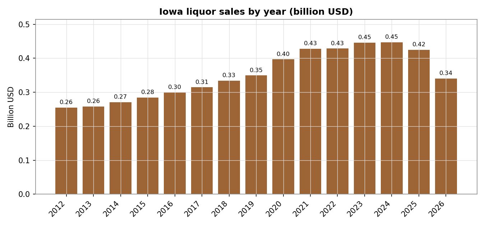

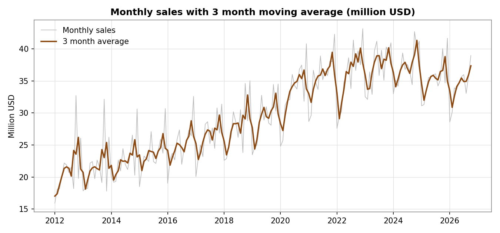

Seasonality is strong and stable. Over the complete years 2012 to 2025, December is the peak month with a seasonality index of 120.8 (100 is an average month) and January is the trough at 81.5. The single biggest month in the dataset is December 2022 at $43.1M.

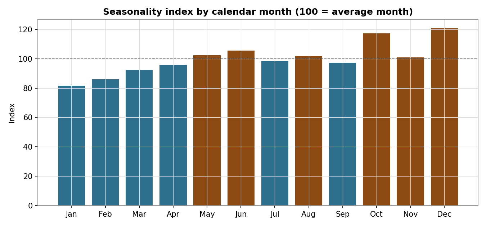

### 2. Categories

Canadian whiskies and American vodkas lead the market with 11.61 and 11.28 percent of all time sales. The biggest long run shift among categories that keep the same name in both years is straight bourbon, which doubled its share from 4.54 percent in 2012 to 9.41 percent in 2025. Whiskey liqueur rose from 2.52 to 6.36 percent, while spiced rum fell from 8.21 to 4.83 percent and Canadian whiskies eased from 11.46 to 10.78 percent.

| Category | All time sales | Share |
| --- | ---: | ---: |
| Canadian Whiskies | $612,040,466 | 11.61% |
| American Vodkas | $594,898,269 | 11.28% |
| Straight Bourbon Whiskies | $388,134,524 | 7.36% |
| Spiced Rum | $322,865,772 | 6.12% |
| Whiskey Liqueur | $286,688,316 | 5.44% |
| 100% Agave Tequila | $233,064,812 | 4.42% |
| Imported Vodkas | $221,726,517 | 4.21% |
| Tennessee Whiskies | $215,135,866 | 4.08% |

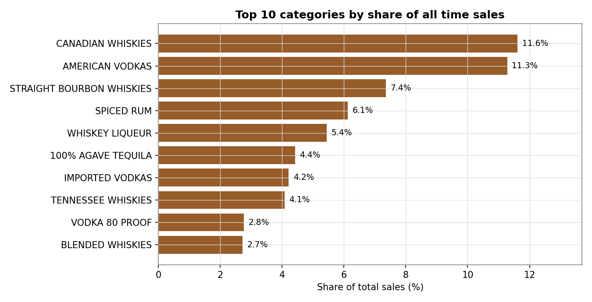

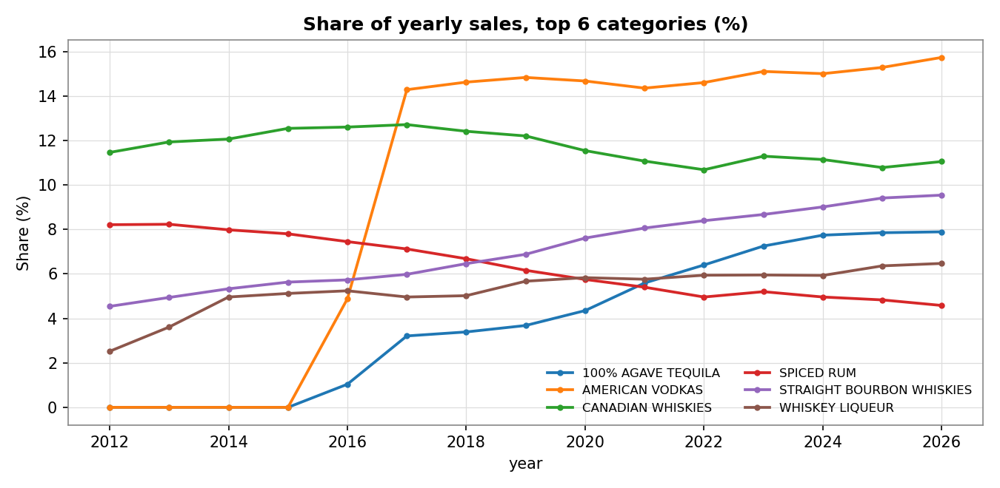

Caution: the category taxonomy itself changed during the period (71 category names in 2012, 48 in 2025). Early names such as Vodka 80 Proof and Tequila were later replaced by American Vodkas and 100% Agave Tequila, so renamed groups are not compared across the full period.

### 3. Stores and counties: a concentrated market

The largest store of all time is Hy-Vee #3 / BDI in Des Moines with $169.0M (3.20 percent of the whole state market), followed by Central City 2 in Des Moines at $151.5M (2.87 percent). Concentration is high:

- The top 10 stores hold 13.35 percent of all sales.
- The top 100 stores hold 44.73 percent.
- Only 132 stores (3.8 percent of 3,520) account for 50 percent of sales, and 628 stores (17.8 percent) account for 80 percent.

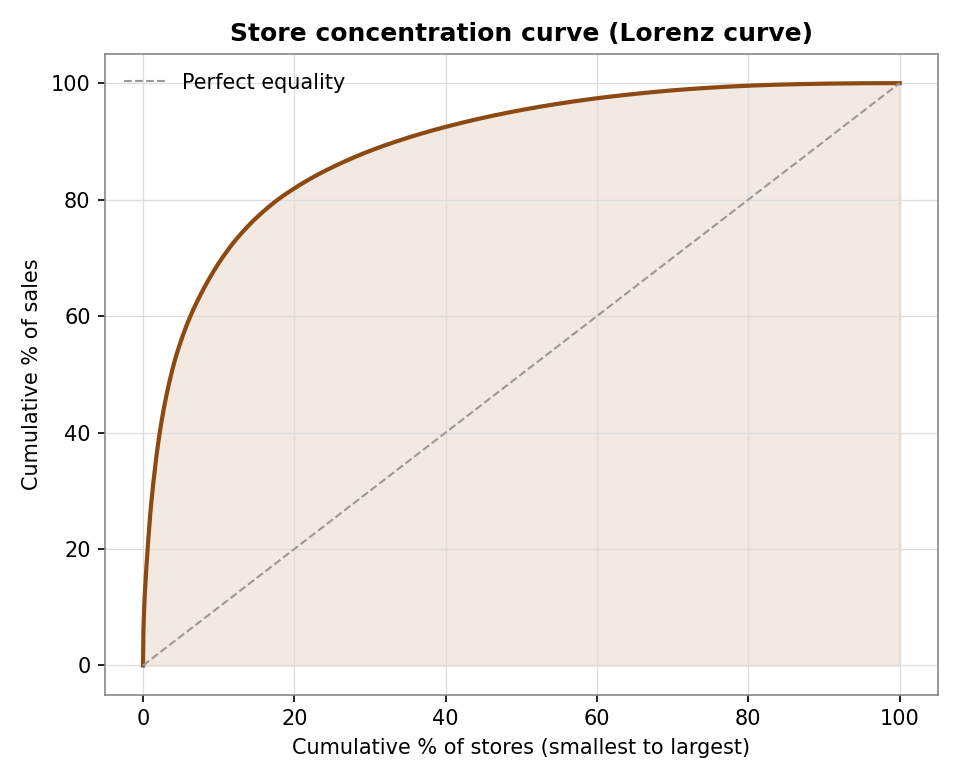

Polk County (Des Moines) alone is 22.97 percent of the state market; the top three counties (Polk, Linn, Scott) together hold 38.48 percent.

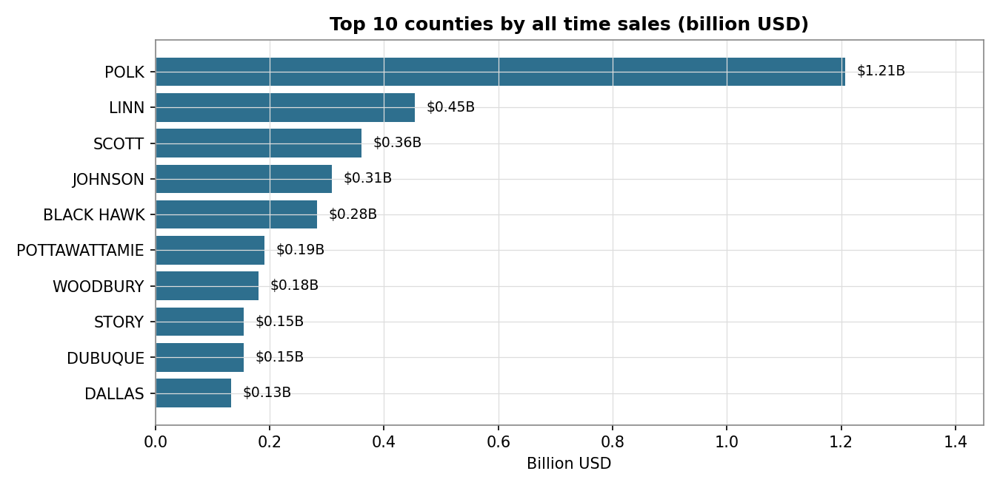

### 4. Price segmentation

Price per liter differs sharply by category. Among categories with substantial volume, single malt Scotch is the most expensive at a weighted average of $60.72 per liter, followed by single barrel bourbon at $49.76 and imported brandies at $46.37. American vodkas sit at the value end at $10.79 per liter (weighted), with an approximate median invoice line price of $8.75 per liter.

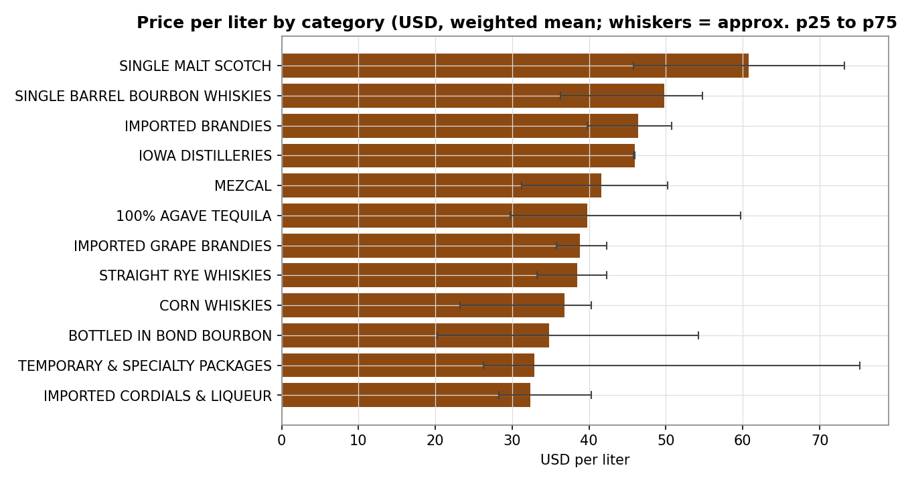

Splitting every invoice line into segments by its price per liter shows where the money and the volume sit:

| Segment (USD per liter) | Share of sales dollars | Share of liters |
| --- | ---: | ---: |
| Value (under 15) | 31.90% | 57.65% |
| Core (15 to 25) | 30.39% | 26.33% |
| Premium (25 to 40) | 24.15% | 12.81% |
| Super premium (40 and above) | 13.56% | 3.21% |

Premium and super premium lines together are 37.7 percent of the dollars but only 16.0 percent of the liters.

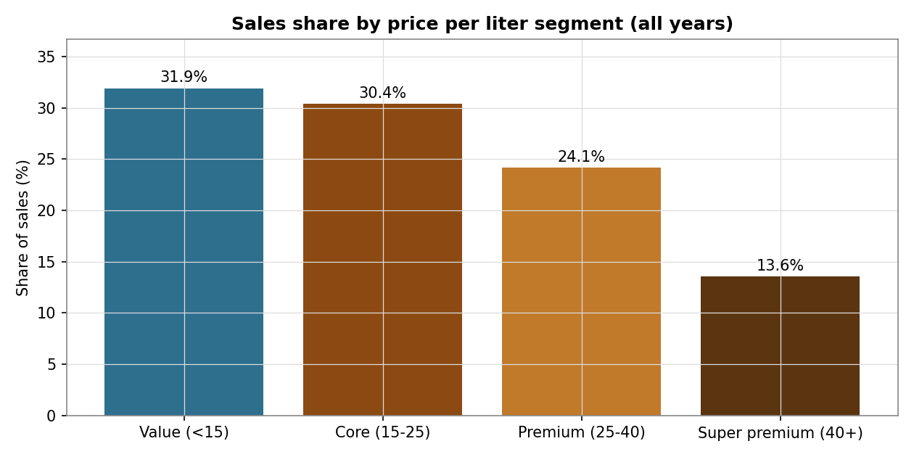

### 5. Anomaly detection

Scoring every store month and product month against its own history (z-score, flag at absolute z of 3 or more, series with at least 24 months) flags 2,572 store months and 4,887 product months for review. The most extreme store month is Circle K #6600 in Muscatine in February 2012: $27,561 against a monthly average of $2,485 (z = 9.77), consistent with a store opening or a first stocking order. The most extreme product month is Bushmills Irish Whiskey in February 2026 at $79,726 against a monthly average of $3,533 (z = 12.86). Flags are review candidates, not proof of errors; openings, closings, promotions, and one off bulk orders all produce them legitimately.

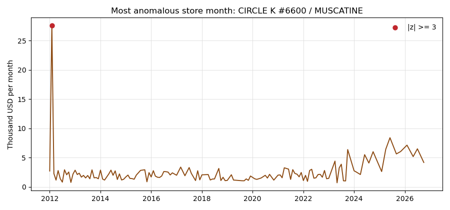

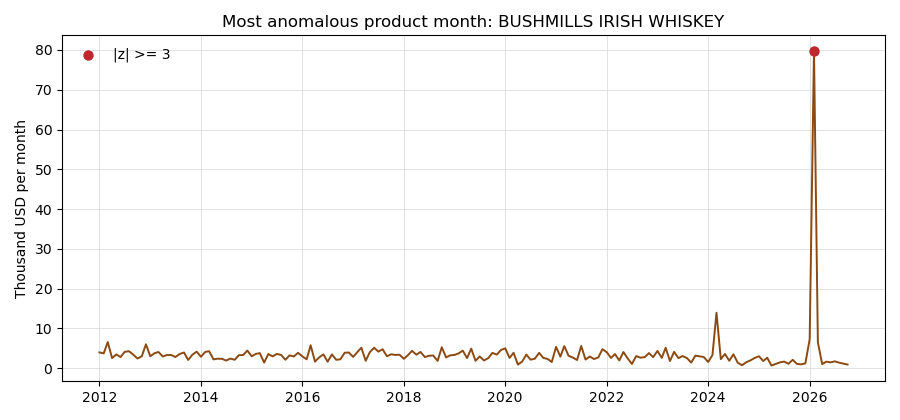

### 6. Vendors: one clear leader

Diageo Americas supplies 20.86 percent of the entire state market by sales value, ahead of Sazerac at 11.20 percent and Pernod Ricard USA at 6.65 percent. The top 10 of 550 vendors together hold 68.21 percent. Because the remaining tail is very fragmented, the Herfindahl Hirschman Index over all vendor shares is 773, which reads as unconcentrated on the conventional scale despite the strong top 10. Both facts are reported because they answer different questions: dependence on the largest suppliers is high, while the overall share distribution is not dominated by one firm.

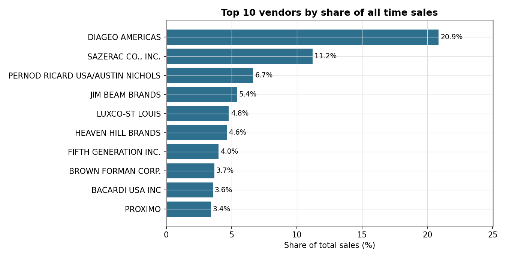

## Dashboard

A self-contained interactive dashboard (no external libraries) lives in `dashboard/index.html` and is generated by `analysis/build_dashboard.py` from the result tables.

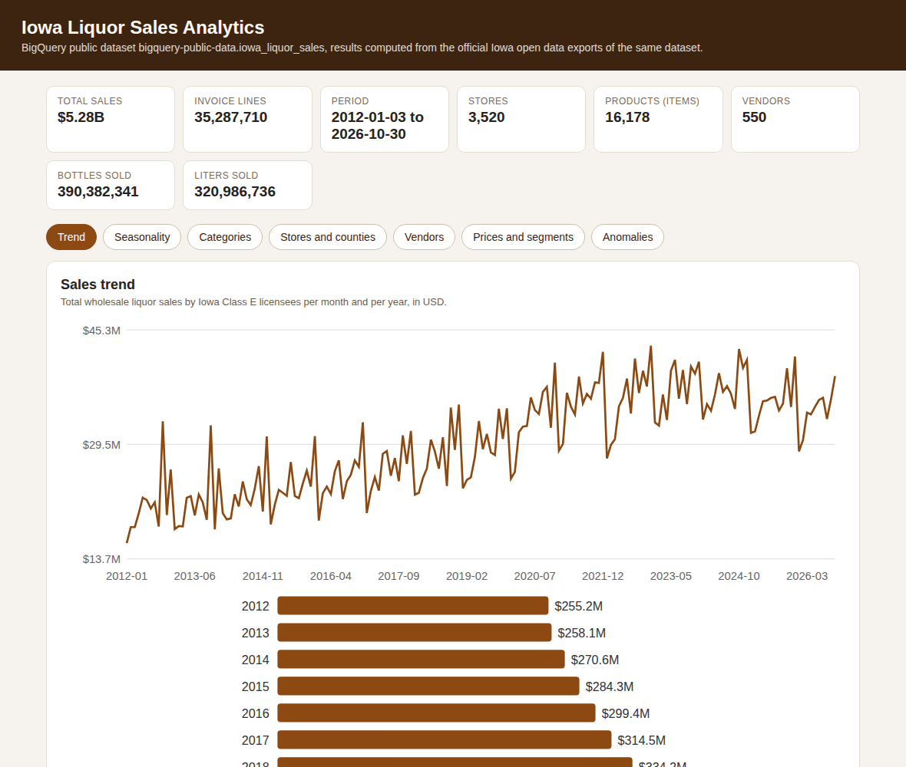

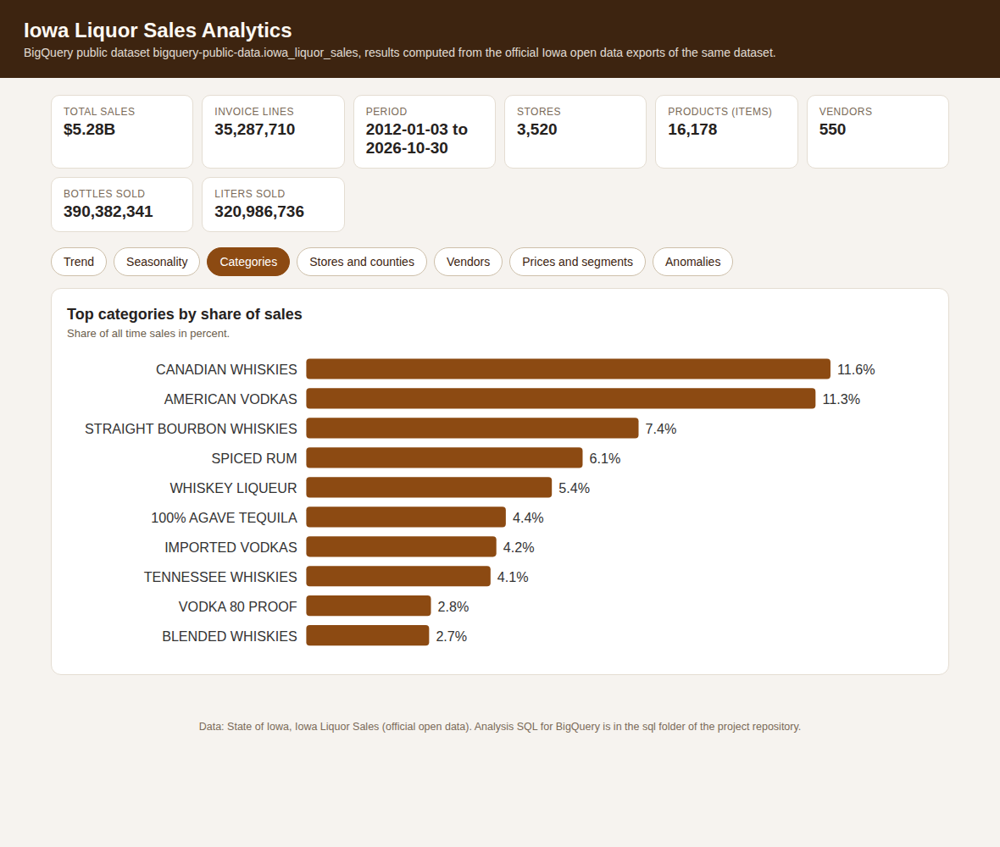

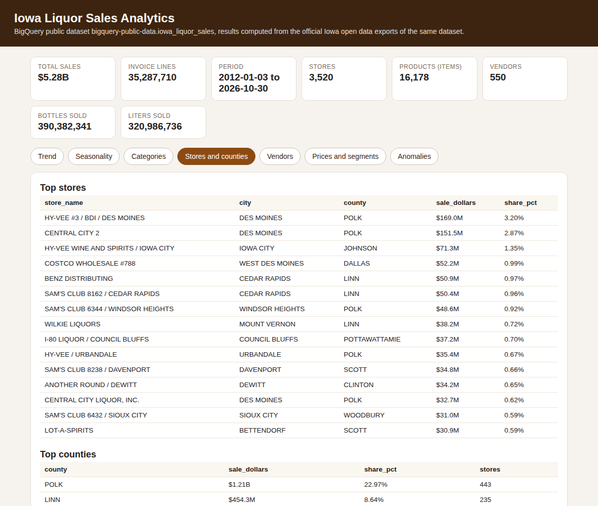

## Run the queries free in BigQuery

1. Open the BigQuery console at console.cloud.google.com/bigquery. Create a Google account if you do not have one. No credit card is needed for the sandbox.
2. Create a project (the sandbox works without a billing account) or use an existing one.
3. In the Explorer panel, open the public dataset: click "Add data", "Star a public dataset", and search for "Iowa Liquor Sales", or query the table directly as `bigquery-public-data.iowa_liquor_sales.sales`.
4. Open the files in `sql/` in order (01 to 07), paste each query into the editor, and run it. The free tier includes 1 TB of query processing per month; a full scan of this table is only a few GB per query, so the whole project fits comfortably inside the free tier. Use the dry run option or the bytes processed estimate in the console if you want to check a query before running it.
5. Queries 07.1 and 07.2 produce the monthly series used by the Python anomaly step; export them as CSV if you want to reproduce `analysis/anomaly_detection.py` purely from BigQuery output.

## Reproduce the published results

```bash
# 1. Download the official yearly exports (about 7.3 GB) from the Iowa Data Hub
python3 analysis/fetch_and_aggregate.py download

# 2. Compute every table in data/results (includes exact duplicate removal)
python3 analysis/fetch_and_aggregate.py aggregate

# 3. Anomaly detection, charts, and dashboard
python3 analysis/anomaly_detection.py
python3 analysis/make_charts.py
python3 analysis/build_dashboard.py

# 4. Validate the results
python3 -m pytest tests/ -q
```

## Methods

- All BigQuery SQL is Standard SQL. The queries demonstrate DATE_TRUNC aggregation, window functions (LAG for year over year growth, rolling averages, cumulative shares for concentration curves), APPROX_QUANTILES for price distributions at scale, and conditional aggregation for share shift matrices.
- Price per liter for a group is always total dollars divided by total liters (volume weighted), never an average of per bottle prices. Per line percentiles in the published tables are approximate, computed from a 0.50 USD histogram of line prices, and are labeled as approximate in `data/results/price_by_category.csv`.
- Seasonality uses complete calendar years only (2012 to 2025), so the partial 2026 year cannot distort the profile.
- Anomaly scores are plain z-scores against each series' own mean and population standard deviation. This is intentionally simple and transparent; it is a screening tool, not a forecasting model.
- Market concentration is shown as a Lorenz style cumulative curve plus the store counts needed to reach 50 and 80 percent of sales. Vendor concentration adds the HHI.

## Data quality notes

- **Exact duplicate rows in the hub exports.** The Iowa Data Hub export generator wrote overlapping part files inside some yearly archives (verified in parts of 2020, 2021, 2022, and 2025), repeating identical rows down to the same invoice id. 1,920,778 exact duplicate rows were removed before computing anything. After removal, the 2020 row count matches the official 2020 catalog entry exactly (2,614,365) and the 2025 count differs from its catalog entry by 7 rows out of about 2.49 million, consistent with the catalog metadata snapshot being older than the export files. The BigQuery public table is built from the combined dataset and is not affected by the export overlap.
- **Returns and corrections.** 11,763 lines (0.03 percent) have negative sales dollars, and 4,953 have zero sales. They are kept in all totals, as the BigQuery queries do.
- **Missing values.** Category is missing on 25,066 lines (0.07 percent) and county on 164,449 lines (0.47 percent); those lines are excluded only from the breakdowns that need the missing field. 100 distinct county values appear: Iowa's 99 counties plus one additional value present in the source.
- **Category taxonomy change.** Category names were reorganized during the period; see the caution in finding 2.

## Limitations

- Sales are wholesale purchases by stores from the state, not consumer purchases. Store ordering patterns (stocking, promotions, December loading) shape the monthly patterns.
- 2026 is a partial year (through October 30) and is excluded from seasonality and from complete year comparisons.
- The published aggregates were computed from the Iowa Data Hub exports, whose column names differ slightly from BigQuery (for example `ordered_on` instead of `date`). The SQL in `sql/` is written and reviewed against the BigQuery schema but was not executed against BigQuery in this environment, which has no Google Cloud credentials.
- Anomaly flags are statistical screens over monthly aggregates. They do not identify causes.

## Project structure

```text
iowa-liquor-sales-bigquery/
  README.md
  LICENSE
  sql/
    01_dataset_overview_and_data_quality.sql
    02_trend_and_seasonality.sql
    03_category_analysis.sql
    04_stores_and_counties_concentration.sql
    05_price_segmentation.sql
    06_vendor_share.sql
    07_anomaly_detection_inputs.sql
  data/
    results/            Aggregate CSVs behind every number in this README
  analysis/
    fetch_and_aggregate.py   Downloads hub exports and computes data/results
    anomaly_detection.py     Z-score flags and anomaly charts
    make_charts.py           All README charts
    build_dashboard.py       Builds dashboard/index.html
  charts/               PNG charts used above
  dashboard/
    index.html          Self-contained interactive dashboard
    dashboard_*.png     Screenshots of the dashboard
  tests/
    test_results.py     Consistency tests for the result tables (15 tests)
```

## License

MIT. The underlying data is published by the State of Iowa under CC BY 4.0 (Iowa Data Hub) and as a Google Cloud public dataset.
